# DMA

there are two DMA in f4, DMA1 and DMA2, each have 8 streams, each stream can map to a
channel from 1 to 8, and each channel can only be mapped to one stream

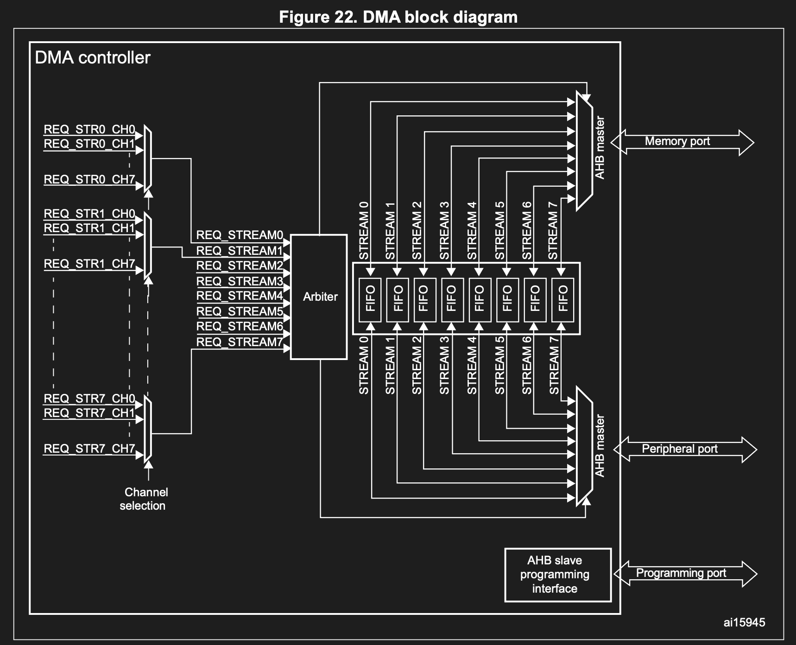

for different channel selection, refer to this

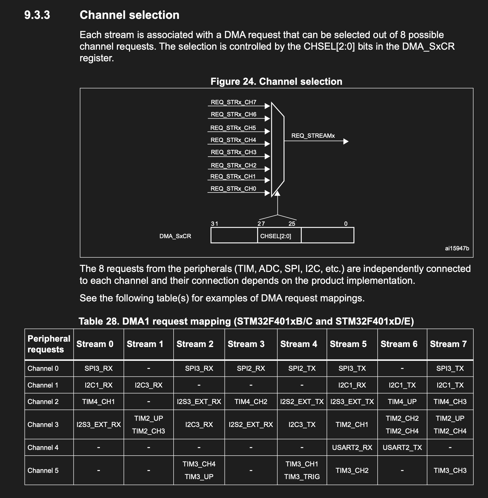
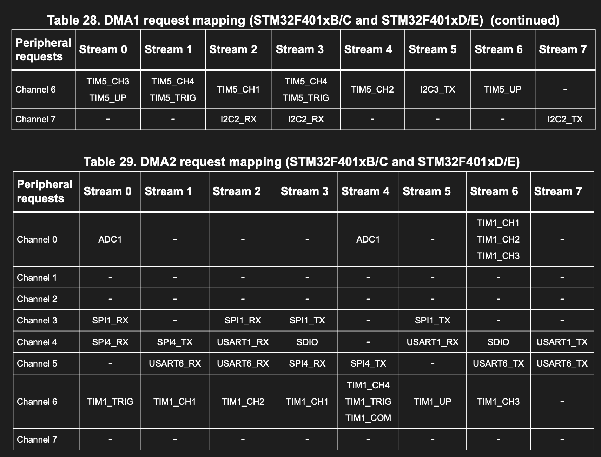

## What Is a Beat?

a beat is one data transfer process, one data transfer process can be 8 byte, 16 or 32 or more,
to configure the size, its done by `MSIZE` in the control register, each trigger is a beat

## DMA Mode

| MODE | FUNCTION |
|---|---|
| CIRCULAR MODE | continous data transfer, DMA finishes and then reloads the count and starts again at the beginning of the same buffer |
| NORMAL MODE | just normal, DMA finishes and then stream disables itself |
| DOUBLE BUFFER | DMA reloads itself and then switches to another buffer. like it will work on buffer A, when A is filled, it switch to B, so A can be processed by MCU. same for when B done it back to A or increment to B + 1. the addrsss of BUFFER A AND B is set in `M0AR` `M1SR` |

## Configuration Register for Stream X

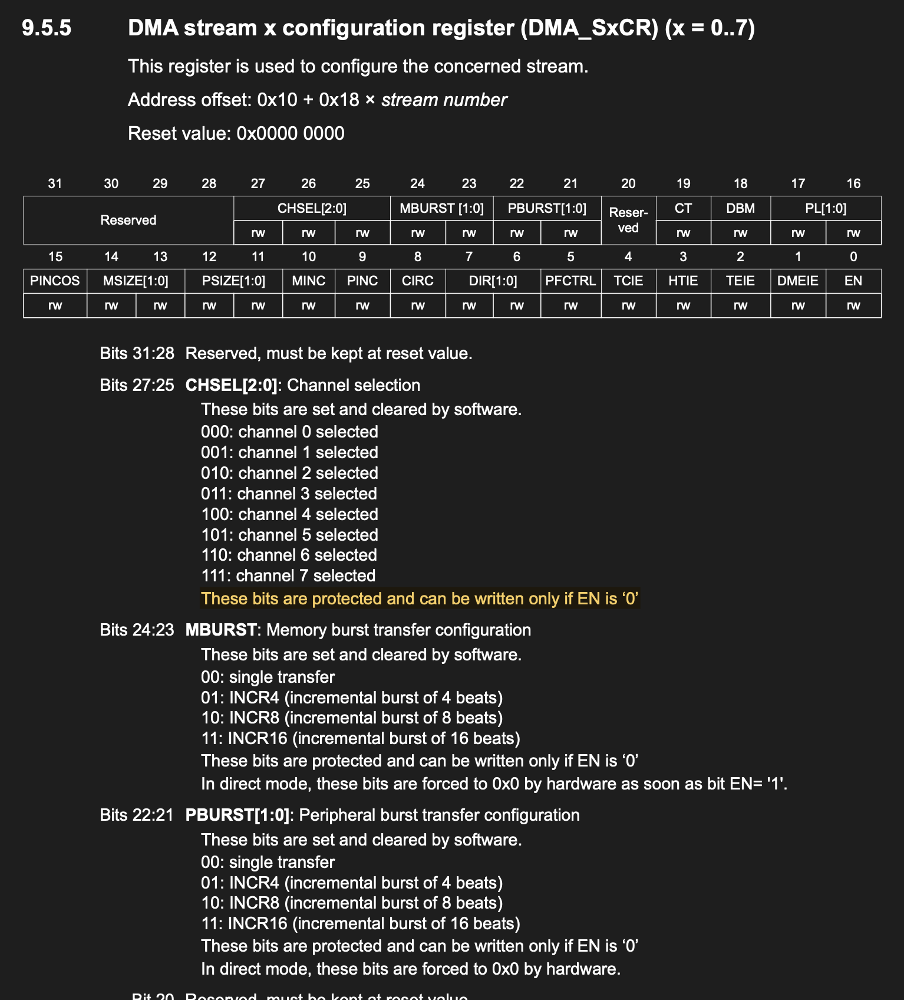
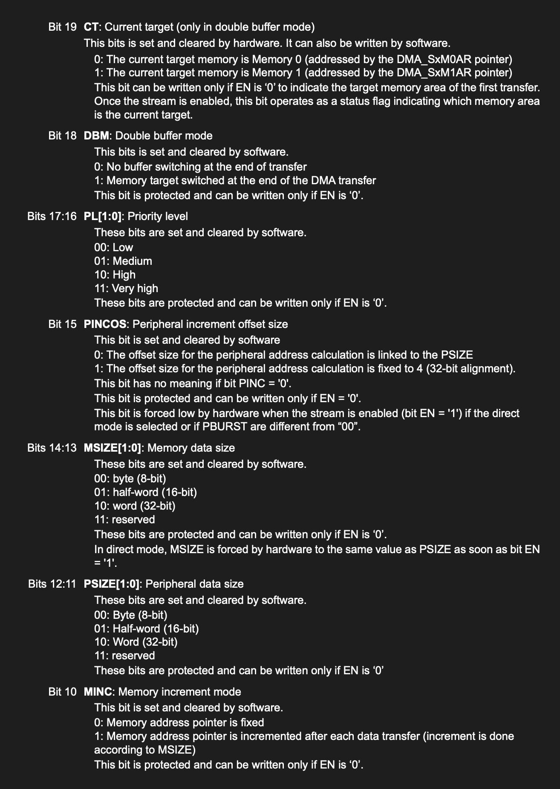
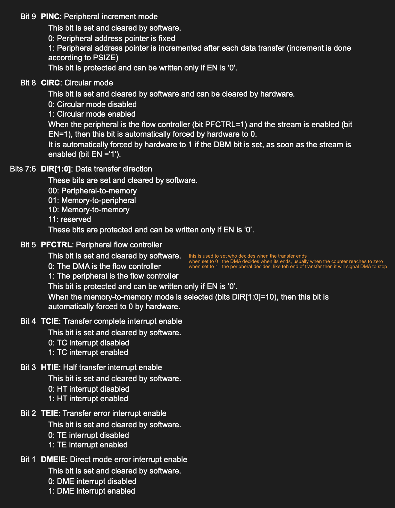
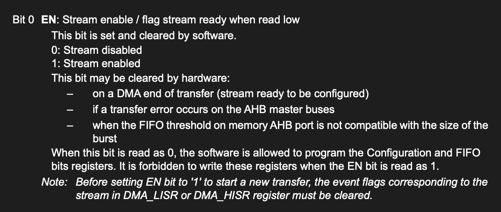

## Number of Data Register for Stream X

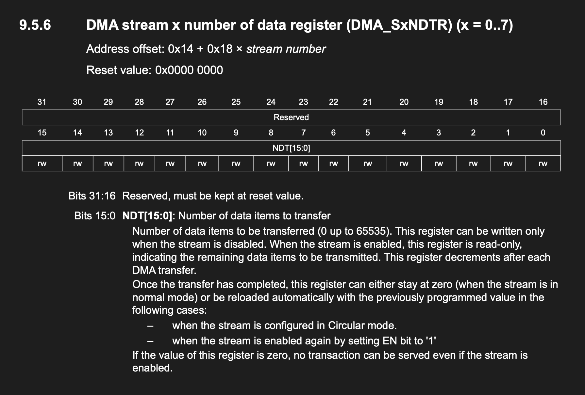

## Peripheral Address Register for Stream X

(this is the register contains address where the data whill be read from to DMA)

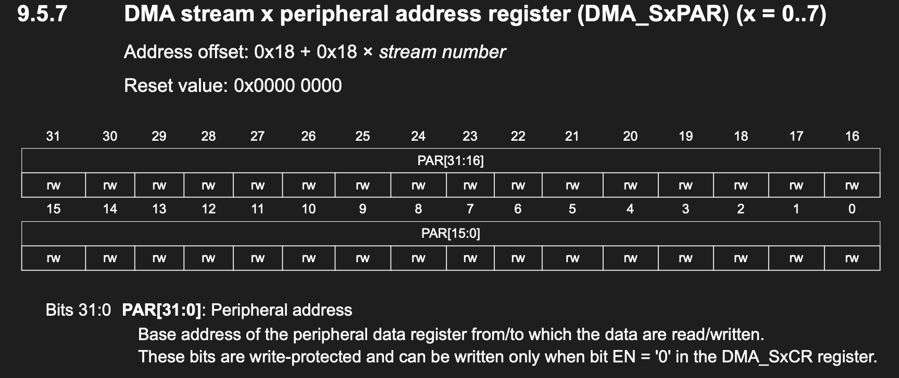

## Memory 0 Address Register for X

(contains destination address of DMA, like where will the data move to)

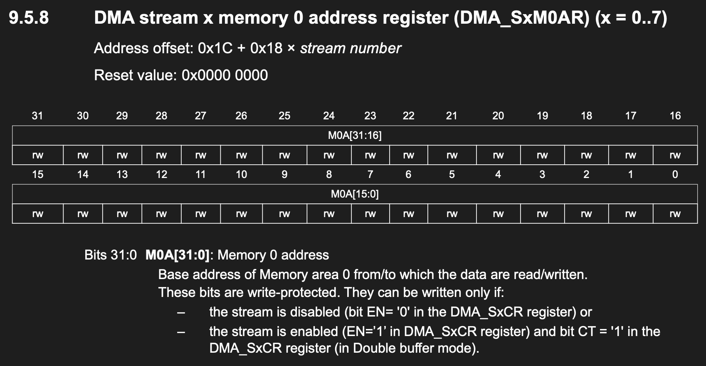

## Memory 1 Address Register for X

(only used when double buffer mode is on, this act as buffer B)

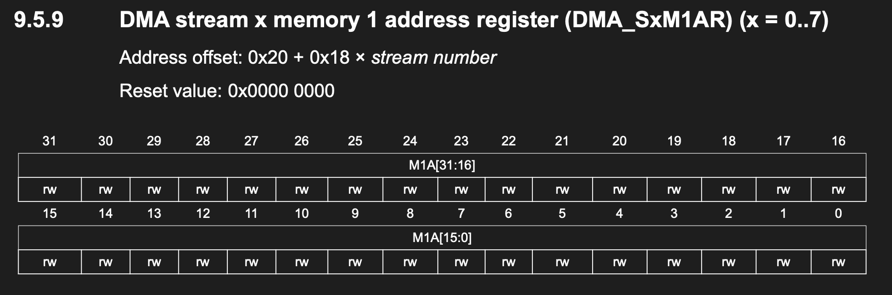
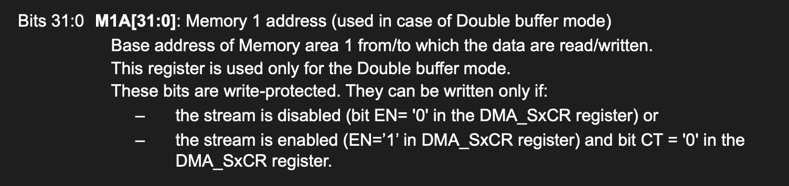
