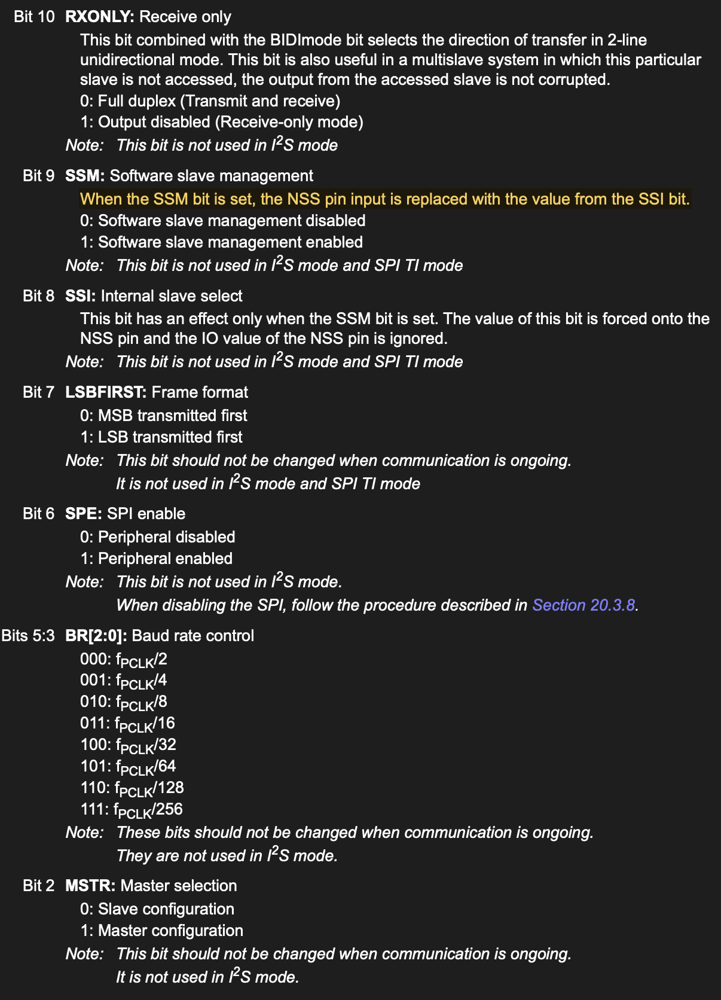
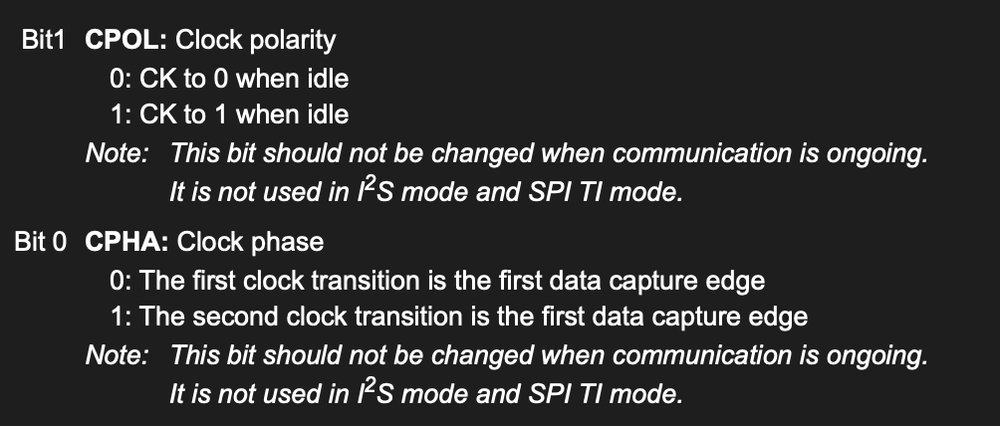
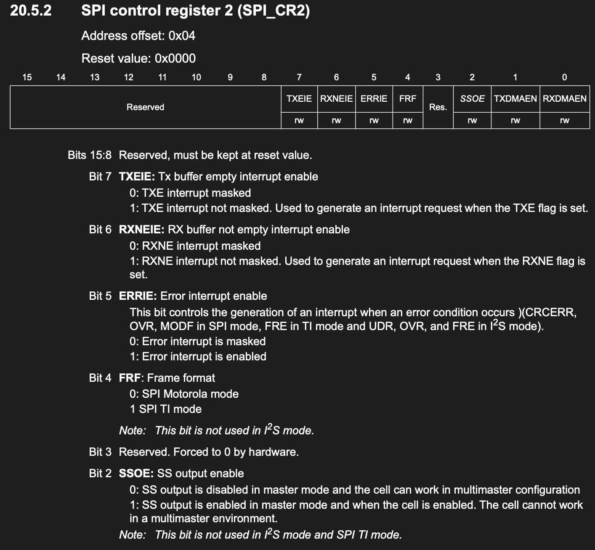
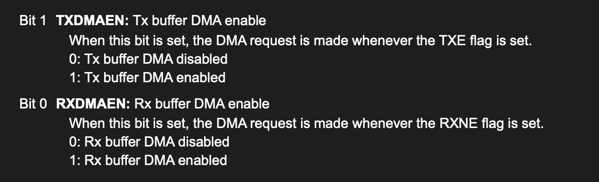
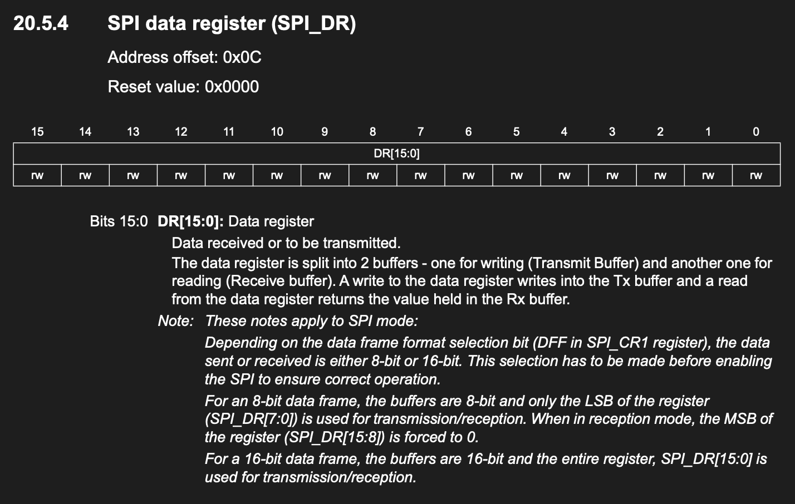
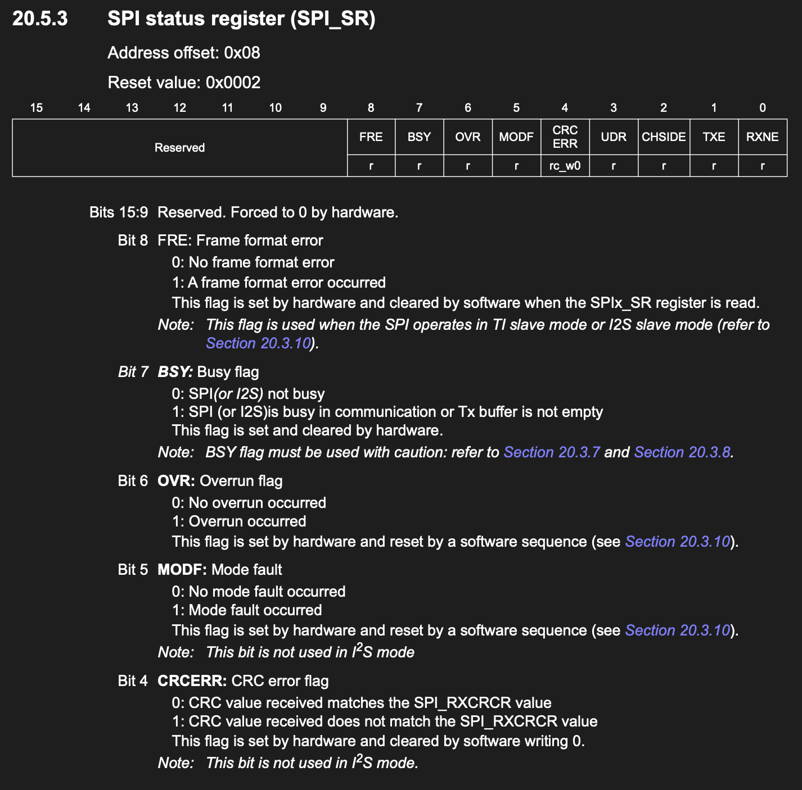
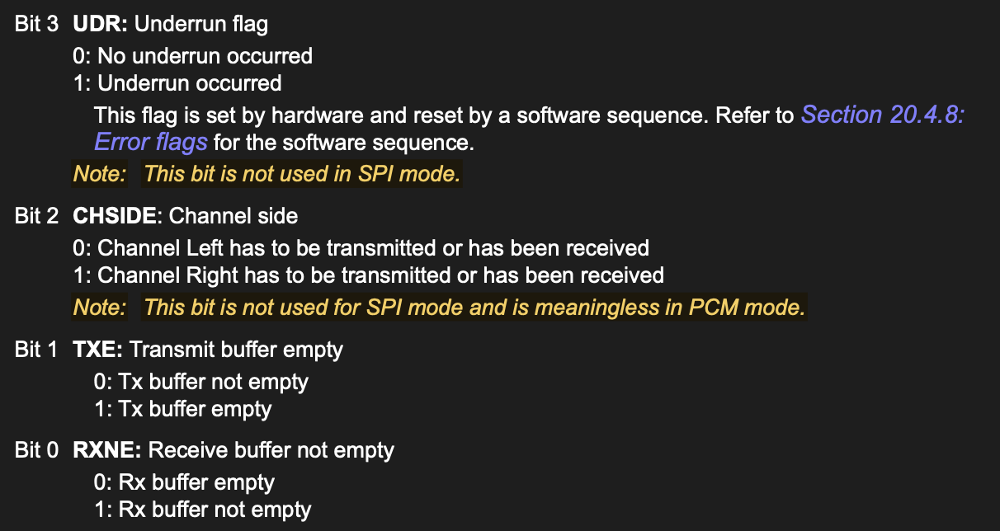

# SPI - I2S - CRC


### steps to setup SPI
- set the mapping GPIO to AF mode and enable clock for GPIO and SPI
- enable clock access on RCC SPI
- set the baud rate
- set mode to master
- set the NSS management and keep the internal NSS high by set `SPI1->CR1 |= SPI_SSM | SPI_SSI;` (master only ?)
- set the clock polarity and phase
- enable spi

```c++
void spi_init(void) {
    // set up gpio with clock enable
    gpio_init(GPIOB, 3, AF);
    gpio_init(GPIOB, 4, AF);
    gpio_init(GPIOB, 5, AF);
    // Select AF5 for PB3, PB4, and PB5.
    GPIOB->AFR[0] &= ~(
        (0xFUL << 12) |
        (0xFUL << 16) |
        (0xFUL << 20)
    );
    GPIOB->AFR[0] |=
        (5UL << 12) |
        (5UL << 16) |
        (5UL << 20);

    //enable clock on SPI 1
    RCC->APB2ENR |= (1UL << 12);

    //SET THE BAUD RATE, TREE ON SPI IS 16M , HERE DEVIDED BY 16 TO GET 1M
    SPI1->CR1 = 0;
    SPI1->CR1 |= (0b011UL << 3);

    // SET MODE TO MASTER
    SPI1->CR1 |= SPI_MSTR;

    //SET CLOCK POLARITY ADN PHASE
    SPI1->CR1 |= (0b10UL << 0);

    // Use software NSS management and keep the internal NSS signal high.
    // Without this, a floating/low hardware NSS input can set MODF and
    // disable SPI1 while it is configured as a master.
    SPI1->CR1 |= SPI_SSM | SPI_SSI;

    // ENABLE SPI
    SPI1->CR1 |= SPI_EN;
}
```


### about the NSS pin
you can set it to the auto hardware pull on CS, but as long as the SPI is on, it will always be low

```c++
typedef struct
{
  __IO uint32_t CR1;        /*!< SPI control register 1 (not used in I2S mode),      Address offset: 0x00 */
  __IO uint32_t CR2;        /*!< SPI control register 2,                             Address offset: 0x04 */
  __IO uint32_t SR;         /*!< SPI status register,                                Address offset: 0x08 */
  __IO uint32_t DR;         /*!< SPI data register,                                  Address offset: 0x0C */
  __IO uint32_t CRCPR;      /*!< SPI CRC polynomial register (not used in I2S mode), Address offset: 0x10 */
  __IO uint32_t RXCRCR;     /*!< SPI RX CRC register (not used in I2S mode),         Address offset: 0x14 */
  __IO uint32_t TXCRCR;     /*!< SPI TX CRC register (not used in I2S mode),         Address offset: 0x18 */
  __IO uint32_t I2SCFGR;    /*!< SPI_I2S configuration register,                     Address offset: 0x1C */
  __IO uint32_t I2SPR;      /*!< SPI_I2S prescaler register,                         Address offset: 0x20 */
} SPI_TypeDef;
```

## SPI_CR1




## SPI_CR2



## SPI_DR


## SPI_SR




