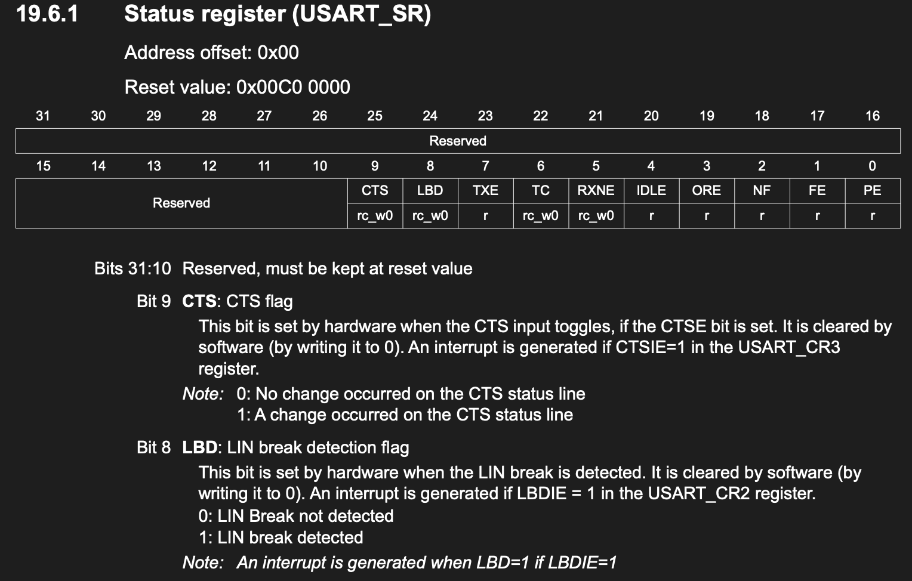
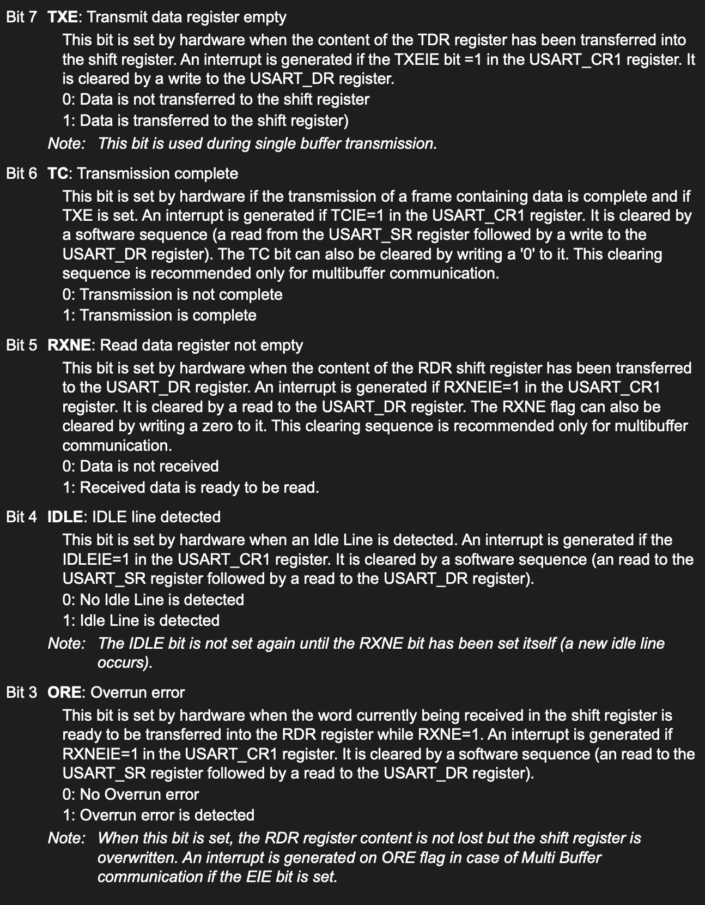
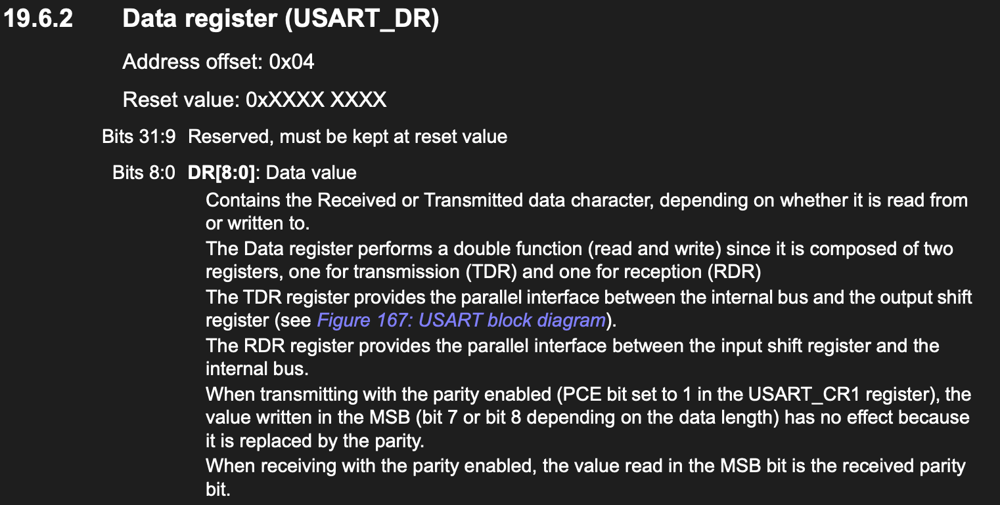
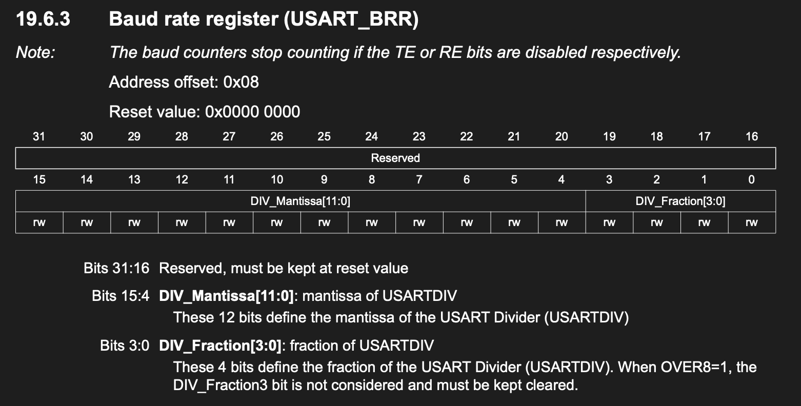
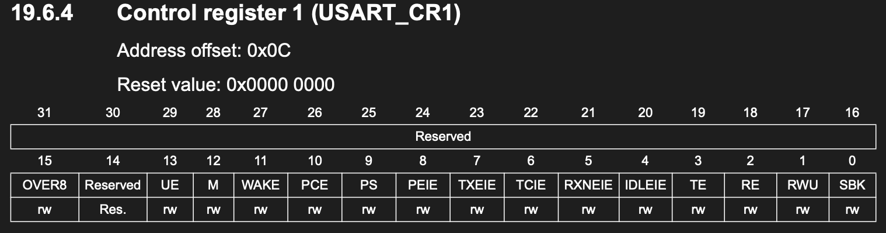
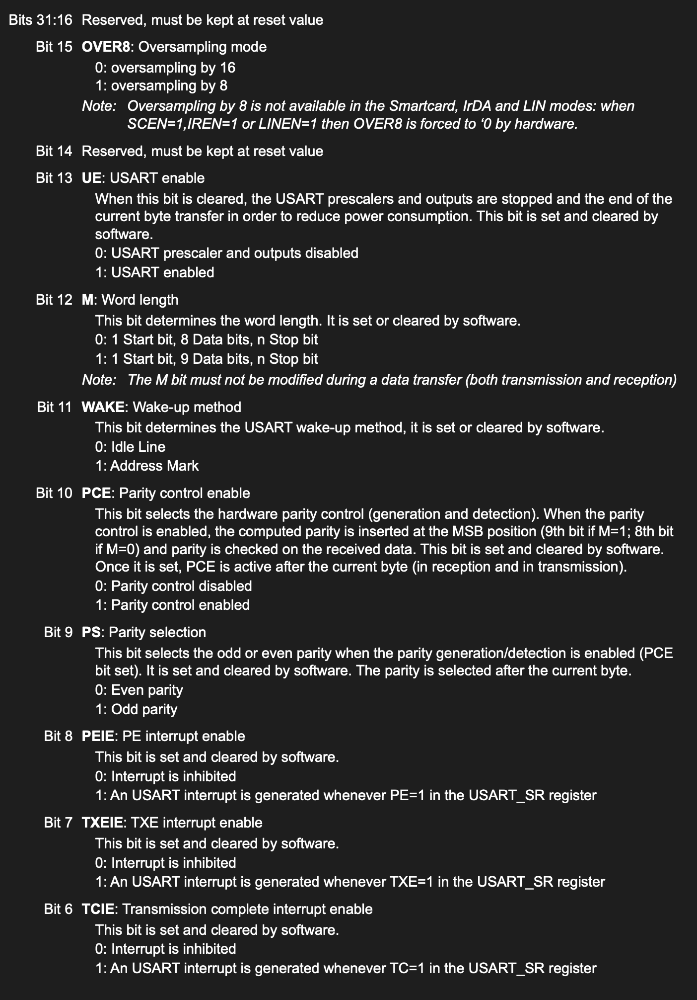
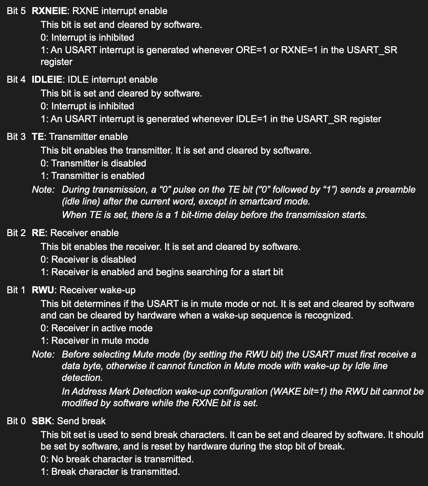

# UART
### general procedure to init a UART
- enable clock of the mapped GPIO
- set pin mode to AF
- configure AF to match the UART
- enable clock of UART
- configure uart baudrate
- configure Control in UART
- retargeting
- send data


## Serial communication
In this category, communication protocols can be further broken down into asynchronous and
synchronous protocols:


1. Asynchronous: This type of communication sends data one bit at a time without a clock
signal to synchronize the sender and receiver. Think of it as sending letters through the mail
without a scheduled delivery time. A common example is UART, which is simple and efficient
for many applications.
2. Synchronous: Unlike asynchronous communication, this form of communication uses a clock
signal to coordinate the transmission of bits. It’s like having a drumbeat to ensure everyone
marches in step. Examples include Serial Peripheral Interface (SPI) and Inter-Integrated
Circuit (I2C). These protocols ensure data integrity and timing, making them suitable for
more complex tasks.

## Parallel communication

1. This type involves transmitting multiple bits simultaneously over multiple channels. Imagine sending
a whole fleet of cars instead of a single one – it’s faster but requires more lanes (or pins, in our case).
While parallel communication is faster, it’s less common in embedded systems due to the higher pin
count. Also, it’s prone to crosstalk and signal integrity problems, especially over longer distances.


## Full-duplex versus half-duplex 
communication protocols can be classified based on their data flow capabilities.

1. Full-duplex: This allows simultaneous two-way communication. Imagine a two-lane road
where cars can travel in both directions at the same time. UART and SPI support full-duplex
communication, making them highly efficient for real-time data exchange.
2. Half-duplex: Here, communication can occur in both directions, but not at the same time –
it’s like a single-lane road where cars must take turns. I2C typically operates in half-duplex
mode, which works well for its intended applications but can be a limitation in high-speed
data scenarios.

#### In ST, there is UART and USART
- Asynchronous mode (UART): In this mode, the USART operates as a traditional UART.
It transmits and receives data without needing a clock signal, which is typical for standard
serial communication.
- Synchronous mode (USART): In this mode, the USART can also operate with a synchronous
clock signal, allowing it to communicate with devices that require a clock line in addition to
the data lines.

## UART protocol
1. start bit : usually high in idle, pull down for one clock cycle to indicate start
2. data frame : 5 ~ 9 bits
3. parity bit: optional feature for basic error checking, if its Even parity this bit is set to 0 if the number of 1s in data frame is even, and set to 1 if odd, reverse for Odd parity
4. end bit: pull up for 1~2 clock cycle to signal end and prepare for buffer for another start

### Baud rate
a baud rate of 9600 means 9600 bits of data is transmitted in a second

## USART Status Register (USART_SR)



## USART Data Register (USART_DR)
**its got two layers, althought its in same address, but you are accessing different registers by writing(access TDR) to it and reading(access RDR) from it, this allocation is handled by hardware**


## USART Baud Rate Register (USART_BRR)

This register has two fields:
1. Mantissa: The integer part of the division factor that sets the baud rate
2. Fraction: The fractional part of the division factor that fine-tunes the baud rate


## USART Control Register 1 (USART_CR1)



`
some elaboration: 
so bit 5, when enabled RXNEIE, system will trigger intrrupt when RXNE reveive not empty, and the ISR can draw the info in the DR to the array
and bit 4, when enable IDLEIE, when 10 clock cycle of high in RX after the last bit is transitted, it will call the intrrupt, and ISR can know the data transfer is done, or silenced, there are transmite done and many other intrrupt registers in this CR, check it out
`


### calculate the BRR value

The clock system inside the STM32 USART peripheral relies on a master division factor called **`USARTDIV`**. This factor is an unsigned fixed-point number that divides the incoming peripheral clock frequency (\(f_{CK}\)) down to your desired transmission target speed.

The foundational equation is:

\[\text{Baud Rate} = \frac{f_{CK}}{\text{Oversampling Factor} \times \text{USARTDIV}}\]

Rearranging this formula to solve for our configuration target, **`USARTDIV`**, gives us:

\[\text{USARTDIV} = \frac{f_{CK}}{\text{Oversampling Factor} \times \text{Target Baud Rate}}\]

#### Determining the Oversampling Factor
The oversampling factor is configured via the **`OVER8`** bit in the `USART_CR1` control register:
*   **When `OVER8 = 0`:** The system oversamples incoming lines by **16**. *(Standard choice for stability)*
*   **When `OVER8 = 1`:** The system oversamples incoming lines by **8**. *(Used for higher execution speeds)*

---

#### Step-by-Step Calculation Procedure

To map the resulting decimal value of `USARTDIV` into the physical **`DIV_Mantissa[11:0]`** (Bits 15:4) and **`DIV_Fraction[3:0]`** (Bits 3:0) registers, follow these four mechanical steps.

#### Step 1: Calculate the Floating-Point Dividend
Run your parameters through the rearranged equation using your specific system bus clock (\(f_{CK}\)).
\[\text{USARTDIV} = \frac{f_{CK}}{16 \times 115200}\]

#### Step 2: Isolate the Mantissa (Integer Component)
The **Mantissa** is simply the absolute integer portion before the decimal point. Take this integer value and convert it directly into a standard 12-bit binary structure.
*   *Example:* If \(\text{USARTDIV} = 8.6805\), the Mantissa integer is **`8`**.
*   *12-Bit Binary:* `0000 0000 1000`

#### Step 3: Compute and Scale the Fraction (Decimal Component)
The fraction bits cannot interpret raw decimals directly (like `.6805`). They must be scaled up to a whole integer representation based on your oversampling mode:

*   **If `OVER8 = 0` (Oversample by 16):** Multiply the decimal remainder by **16**, then round to the nearest whole integer.
    \[\text{Fractional Integer} = \text{round}(\text{Decimal Remainder} \times 16)\]
*   **If `OVER8 = 1` (Oversample by 8):** Multiply the decimal remainder by **8**, then round to the nearest whole integer.
    \[\text{Fractional Integer} = \text{round}(\text{Decimal Remainder} \times 8)\]

Convert this scaled fractional integer into a 4-bit binary sequence.

#### Step 4: Concatenate into the 16-Bit Register Layout
Pack the two binary segments adjacent to each other. The final register layout mirrors this architecture:

```text
Bits 15                               Bits 4 │ Bits 3         Bits 0
 ┌───────────────────────────────────────────┼─────────────────────┐
 │       DIV_Mantissa[11:0] (12 Bits)        │ DIV_Fraction[3:0]   │
 └───────────────────────────────────────────┴─────────────────────┘
```

---

#### Worked Blueprint: 16 MHz Clock at 115,200 Baud (`OVER8 = 0`)

Here is how the theoretical steps operate using standard internal hardware constants.

#### 1. Master Division Factor
\[\text{USARTDIV} = \frac{16,000,000}{16 \times 115,200} = \frac{16,000,000}{1,843,200} = \mathbf{8.680555...}\]

#### 2. Extract Mantissa
*   Integer Portion = `8`
*   Binary Expression = **`0000 0000 1000`**

#### 3. Extract and Scale Fraction
*   Decimal Remainder = `0.680555...`
*   Scale up (\(\times 16\)): \(0.680555 \times 16 = 10.8888...\)
*   Round to nearest whole number = `11`
*   Binary Expression = **`1011`**

#### 4. Construct Register Bit Pattern

| Component | Target Allocation | Binary Field Value | Hex Equivalent |
| :--- | :--- | :--- | :--- |
| **Mantissa** | `Bits [15:4]` | `0000 0000 1000` | `0x008` |
| **Fraction** | `Bits [3:0]` | `1011` | `0xB` |

*   **Assembled Binary Representation:** `0b0000000010001011`
*   **Assembled Hexadecimal Value:** `0x008B`

---

#### Critical Hardware Constraints: `OVER8 = 1` Exception

If you configure your system to run with **`OVER8 = 1`**, you must watch out for a physical limitation in the fractional sizing engine:

1. The scaling calculation multiplier changes strictly from **\(\times 16\)** to **\(\times 8\)**.
2. Because the fractional resolution scales down, **Bit 3 (`DIV_Fraction[3]`) is entirely ignored by the hardware internal decoder and must always be kept cleared (`0`)** in your configuration.
3. The remaining 3 calculated data bits must reside solely within positions **`Bits [2:0]`**.

### Function ready to use to calculate this register
```c++
static uint16_t compute_uart_bd(uint32_t periph_clk, uint32_t baudrate)
{
    return ((periph_clk + (baudrate / 2U)) / baudrate);
}

static void uart_set_baudrate(uint32_t periph_clk, uint32_t baudrate)
{
    USART2->BRR = compute_uart_bd(periph_clk, baudrate);
}
```
### Retargeting: use naive ```printf()```
```c++
int __io_putchar(int ch)
{
    uart_write(ch);
    return ch;
}
// and to use it
printf("Hello from STM32...\r\n");
```


